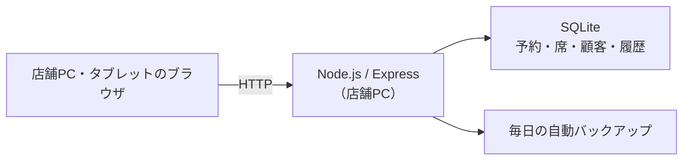

# NISHI Board — 予約・席管理アプリ

ロサンゼルスの焼き鳥店 YAKITORI NISHI で、実際の営業に使われている予約・席管理アプリです。
店舗のPCでサーバーを動かし、PCと店内タブレットのブラウザから同じデータを扱います。

> このリポジトリは就職活動向けの紹介資料です。アプリ本体のソースコードは非公開で、掲載画像はすべて架空のデモデータです。

## 作ったきっかけ

アルバイト先の焼き鳥店では、予約を紙の台帳で管理していました。同じ時間・同じ卓の予約が重なっても気づけず、席の空き状況もスタッフ間の口頭での伝達に頼っていました。

そこで、予約と席の状況を一か所にまとめ、どの端末からでも同じ情報を見られるようにしようと考え、自分で提案して開発しました。スタッフの声をもとに改善を重ね、現在も営業中に使われています。

## できること

- 予約の登録・変更・検索、日付別の一覧とカレンダー表示
- 同じ営業日・同じ卓で時間が重なる予約を、登録時に検出して確認を求める
- 空席・着席・卓移動・退店をサーバーで共有し、各端末の画面に反映
- 電話番号から同じお客様を判定して、来店履歴を表示
- スタッフ／管理者の権限分け、JSONの書き出し・読み込み、毎日の自動バックアップ

## 画面イメージ

以前に用意したデモ画像です。「Demo Guest」と555から始まる電話番号は、すべて架空のものです。

### 予約一覧（PC）

### 卓の配置図（PC）

スマートフォン表示を見る

## 技術構成

| 技術 | 選んだ理由 |
|---|---|
| Node.js / Express | 店舗PC1台で、画面の配信とAPIをまとめて動かせる |
| SQLite / better-sqlite3 | DBサーバーを別に用意せず、1台でデータを保持できる |
| HTML / CSS / JavaScript | ビルド工程を作らず、ブラウザだけで業務画面を使える |
| Node.js標準のテストランナー | 追加のライブラリなしで、APIのテストを書ける |

店舗PC1台と店内の端末、という運用規模に合わせて、構成要素の少ない作りにしました。
→ [構成図の補足](docs/diagrams/README.md)

## 設計で気をつけたこと

**同時編集で予約が上書きされないようにする**
PCとタブレットから同じ予約を同時に触ることがあります。保存時に、画面を開いたときの更新時刻と現在のデータを比べ、他の端末が先に変更していた場合は保存を中止します。

**「予約の予定」と「今の卓の状態」を分ける**
先に予約が入っていることと、その卓が今使われていることを、同じ状態として扱いません。分けておくことで、予約のある卓を閉店前まで使う、といった現場の判断ができます。

**深夜営業の「1日」を揃える**
営業時間が16:00〜翌01:00のため、深夜00:30の予約も前日の営業日として数えます。日付の計算はサーバー側でロサンゼルス時間に固定し、端末ごとにずれないようにしています。

## テスト

予約APIのテスト52件を、実店舗のデータとは切り離した一時DBとダミー認証で実行しています。重複予約の検出、古い画面からの保存、深夜の営業日、バックアップと復元などを確認し、タイムゾーンを変えても同じ結果になることを見ています（Node.js 24 で52件すべて成功）。

## 開発の進め方

個人開発です。実装・確認・修正ではAI（Claude・Codex）を補助に使い、業務ルール・公開範囲・テスト仕様の判断は自分で行っています。

## 公開範囲と制約

- 本体のソースコード、店舗のDB、顧客情報、認証設定は非公開です。
- 信頼する店内LANでの利用を前提としていて、インターネットには公開していません。
- ブラウザ側の日付判定は端末のタイムゾーンに依存するため、サーバーの営業日に合わせる改善を検討しています。
