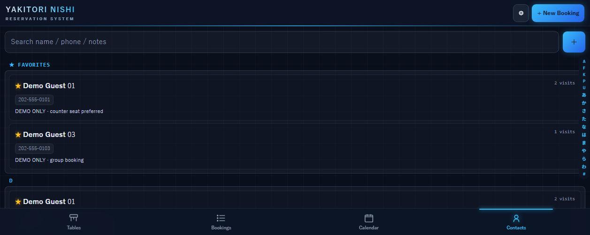
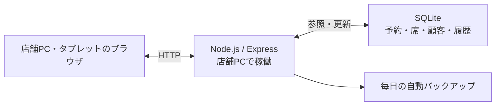

# NISHI Board — 焼き鳥店の予約・席管理アプリ

ロサンゼルスの焼き鳥店 YAKITORI NISHI で、実際の営業に使われている予約・席管理アプリです。
在学中の勤務先で、紙の予約台帳による二重予約に着目し、Webアプリでの予約管理を自ら提案しました。授業で学んだプログラミングとアルゴリズムの知識を基礎に、AIも活用して開発しました。

- **担当**：課題整理・導入提案、設計、実装、テスト、運用改善。個人開発でAIも活用し、スタッフの声をもとに改善を継続
- **技術**：Node.js / Express / SQLite（better-sqlite3）/ HTML・CSS・JavaScript
- **利用環境**：店舗PC 1台でサーバーを動かし、店内のPC・タブレットのブラウザから利用

> 就職活動向けの紹介リポジトリです。アプリ本体のソースコードは非公開で、掲載画像はすべて架空のデモデータです。

## 対応した業務課題

| 紙の台帳での課題 | NISHI Board での対応 |
|---|---|
| 同じ時間・同じ卓の予約が重なっても気づけない | 登録時に重複を検出し、確認を求める |
| 席の空き状況を口頭で伝えている | 着席・卓移動・退店をサーバーで共有し、他の店内端末の画面にも反映 |

ほかに、電話番号による来店履歴の表示、日別の予約集計、スタッフ／管理者の権限分け、JSONの書き出し・読み込み、毎日の自動バックアップに対応しています。

## 画面

デモ専用DBで実際に操作して撮影しました。

<table>
<tr>
<td width="50%"> <b>予約を登録</b> — 保存すると一覧に反映</td>
<td width="50%"> <b>着席</b> — 卓が緑になり、人数・経過時間を表示</td>
</tr>
<tr>
<td> <b>卓を移動</b> — T1が空席に戻り、T3が使用中に</td>
<td> <b>退店</b> — 空席に戻し、来店履歴を記録</td>
</tr>
<tr>
<td> <b>来店履歴</b> — 今回と過去の来店をまとめて表示</td>
<td> <b>電話帳</b> — 名前・電話番号・メモで検索、五十音／A–Z索引付き</td>
</tr>
<tr>
<td> <b>日別集計</b> — 予約組数・総人数・Walk-inを自動で更新</td>
<td> <b>予約タイムライン</b> — 卓ごとの予約を時間帯で表示。空き枠から登録</td>
</tr>
</table>

## 設計で工夫したこと

- **予約条件を登録時に確認する** — 卓の重複に加えて、定員オーバーと閉店時刻を過ぎる予約も検出し、スタッフに確認を求めます。現場の判断で「それでも登録する」こともできます。
- **古い画面からの上書きを検出する** — PCとタブレットから同じ予約を同時に触ることがあるため、保存時に更新時刻を比べ、他の端末が先に変更していたら保存を中止します。
- **「予約の予定」と「今の卓の状態」を分ける** — 予約が入っている卓でも、閉店前まで別のお客様に使う、といった現場の判断ができます。
- **深夜営業の「1日」を揃える** — 営業時間が16:00〜翌01:00のため、00:30の予約も前日の営業日として数えます。日付計算はサーバー側でロサンゼルス時間に固定しています。
- **必要なデータだけ保存する** — 変更履歴は「変わった項目」だけを記録し、何も変わっていない保存では書き込みも履歴の追加もしません。

## セキュリティの工夫と前提

店舗内の信頼できるLANでの利用を前提とし、インターネットから直接アクセスさせる構成は想定していません。

- **認証と権限**：ログインとスタッフ／管理者の権限分離を実装。復元は管理者限定、全削除は再認証が必要です。同じ接続元からログインに5回続けて失敗すると60秒間ロックします。
- **送信元の確認**：データを更新するAPIでは、Originヘッダーがある場合に送信元のホスト・ポートを照合し、不一致のリクエストを拒否します。
- **通信の前提**：HTTP通信は暗号化していません。来客用Wi-Fiとの分離など、店舗側でネットワークを管理する必要があります。
- **保存データの管理**：SQLite・バックアップ・書き出したJSONは、アプリ側で暗号化していません。端末のアクセス制限・画面ロック・ディスク暗号化、持ち出しファイルの保管・削除ルールが必要です。
- **バックアップ**：毎日の自動保存と手動のJSON書き出しに対応しています。gzipは圧縮であり、暗号化ではありません。

## 技術構成

| 技術 | 選んだ理由 |
|---|---|
| Node.js / Express | 店舗PC1台で、画面の配信とAPIをまとめて動かせる |
| SQLite / better-sqlite3 | DBサーバーを別に用意せず、1台でデータを保持できる |
| HTML / CSS / JavaScript | ビルド工程なしで、ブラウザだけで使える |
| Node.js標準のテストランナー | 追加ライブラリなしでAPIのテストを書ける |

店舗PC1台と店内端末という運用に合わせ、画面配信・API・DBを店舗PCにまとめています。→ [詳しい構成図](docs/diagrams/README.md)

## テスト

- **自動テスト 18件すべて成功**（Node.js 24、デモ専用DB）— 重複予約、同時編集、卓移動・退店、深夜の営業日、バックアップ・復元
- **画面操作での確認** — 集計の更新、日付の切り替え、タイムラインからの予約登録・時間変更、キャンセルの反映、電話帳の検索

## 自分で判断したことと、AIの使い方

- **自分で判断**：解決する課題の選定、営業日・卓・定員などの業務ルール、画面と機能の仕様、テストで確認する観点、公開する範囲
- **AI（Claude・Codex）との協働**：設計・実装の検討、コードの作成・確認・修正に活用。要件の整理から実装・テスト・運用改善まで、AIも使いながら進めています。
