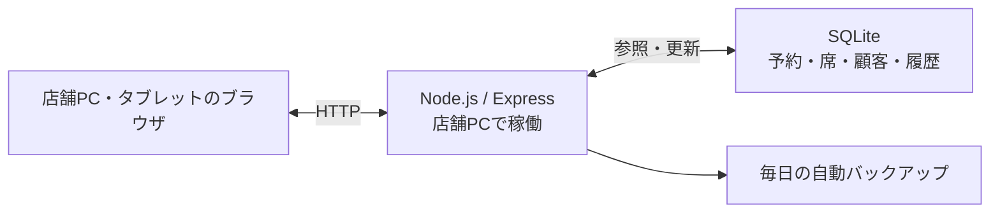

# NISHI Board — 焼き鳥店の予約・席管理アプリ

ロサンゼルスの焼き鳥店 YAKITORI NISHI で、**実際の営業に使われている**予約・席管理アプリです。
アルバイト先で紙の台帳による予約の重複や、席状況の伝達漏れが起きていたため、自分で提案して個人で開発しました。

- **担当**：個人開発（提案・設計・実装・テスト）。スタッフの声をもとに改善を継続
- **技術**：Node.js / Express / SQLite（better-sqlite3）/ HTML・CSS・JavaScript
- **利用環境**：店舗PC 1台でサーバーを動かし、店内のPC・タブレットのブラウザから利用

> 就職活動向けの紹介リポジトリです。アプリ本体のソースコードは非公開で、掲載画像はすべて架空のデモデータです。

## 解決したこと

| 紙の台帳での課題 | NISHI Board での解決 |
|---|---|
| 同じ時間・同じ卓の予約が重なっても気づけない | 登録時に重複を検出し、確認を求める |
| 席の空き状況を口頭で伝えている | 着席・卓移動・退店をサーバーで共有し、全端末に反映 |

ほかに、電話番号による来店履歴の表示、日別の予約集計、スタッフ／管理者の権限分け、JSONの書き出し・読み込み、毎日の自動バックアップに対応しています。

## 画面

デモ専用DBで実際に操作して撮影しました。

<table>
<tr>
<td width="50%"> <b>予約を登録</b> — 保存すると一覧に反映</td>
<td width="50%"> <b>着席</b> — 卓が緑になり、人数・経過時間を表示</td>
</tr>
<tr>
<td> <b>卓を移動</b> — T1が空席に戻り、T3が使用中に</td>
<td> <b>退店</b> — 空席に戻し、来店履歴を記録</td>
</tr>
<tr>
<td> <b>来店履歴</b> — 今回と過去の来店をまとめて表示</td>
<td> <b>電話帳</b> — 名前・電話番号・メモで検索、五十音／A–Z索引付き</td>
</tr>
<tr>
<td> <b>日別集計</b> — 予約組数・総人数・Walk-inを自動で更新</td>
<td> <b>予約タイムライン</b> — 卓ごとの予約を時間帯で表示。空き枠から登録</td>
</tr>
</table>

## 設計で工夫したこと

- **同時編集で予約が上書きされない** — PCとタブレットから同じ予約を同時に触ることがあるため、保存時に更新時刻を比べ、他の端末が先に変更していたら保存を中止します。
- **「予約の予定」と「今の卓の状態」を分ける** — 予約が入っている卓でも、閉店前まで別のお客様に使う、といった現場の判断ができます。
- **深夜営業の「1日」を揃える** — 営業時間が16:00〜翌01:00のため、00:30の予約も前日の営業日として数えます。日付計算はサーバー側でロサンゼルス時間に固定しています。

## 技術構成

| 技術 | 選んだ理由 |
|---|---|
| Node.js / Express | 店舗PC1台で、画面の配信とAPIをまとめて動かせる |
| SQLite / better-sqlite3 | DBサーバーを別に用意せず、1台でデータを保持できる |
| HTML / CSS / JavaScript | ビルド工程なしで、ブラウザだけで使える |
| Node.js標準のテストランナー | 追加ライブラリなしでAPIのテストを書ける |

店舗PC1台という運用規模に合わせ、構成要素を最小限にしました。→ [詳しい構成図](docs/diagrams/README.md)

## テスト

- **自動テスト 18件すべて成功**（Node.js 24、デモ専用DB）— 重複予約、同時編集、卓移動・退店、深夜の営業日、バックアップ・復元
- **画面操作での確認** — 集計の更新、日付の切り替え、タイムラインからの予約登録・時間変更、キャンセルの反映

## 開発の進め方

実装・確認・修正ではAI（Claude・Codex）を補助に使い、業務ルール・公開範囲・テスト仕様の判断は自分で行っています。

## 制約と今後の課題

- 信頼する店内LANでの利用が前提で、インターネットには公開していません。
- ブラウザ側の日付判定は端末のタイムゾーンに依存するため、サーバーの営業日に揃える改善を検討しています。
